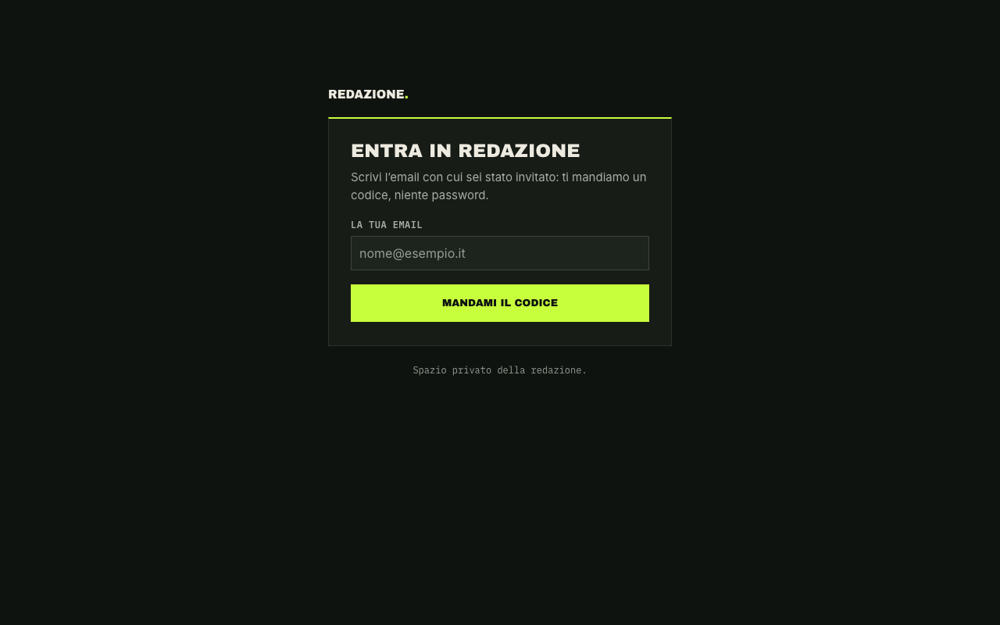
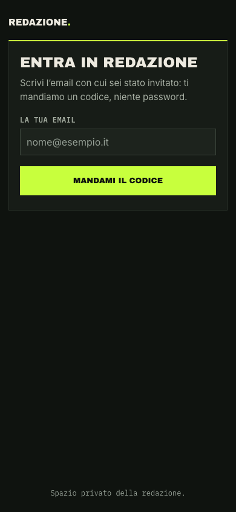

# La Redazione

[](https://github.com/rblvince/la-redazione/actions/workflows/ci.yml)

A small editorial room for proposing, discussing, verifying, and deciding which topics to cover. The interface is in Italian.

Members work through a topic from proposal to publication, with discussion, votes, source tracking, verification and legal checklists, review assignments, and an archive. The three roles are **maintainer**, **decider**, and **member**. Access is invite-only; members sign in with an eight-digit email OTP.

## Screenshots

| Sign in | Mobile |
| --- | --- |
|  |  |

## Stack

Next.js 16 App Router, TypeScript, Supabase Auth/Postgres/Storage with row-level security, Vitest, Playwright, and Vercel.

## Technical and security choices

- Server-rendered pages and server actions keep privileged operations on the server.
- PostgreSQL functions enforce workflow rules; RLS limits data access to active members.
- Invitations are single-use, email-bound, expire after seven days, and store only a token hash.
- All topic, source, and post links require HTTPS. Security headers are configured centrally.
- Unit and database tests use Vitest; database tests run against local PGlite and do not require a live Supabase project.

See [the architecture notes](docs/architecture.md) for the data model, roles, access flow, and database protections.

## Run locally

Requirements: Node.js 24, pnpm 12.5.1, and the Supabase CLI. The included handbook is demonstrative text. Create a Supabase project of your own, then configure its URL and keys in `.env.local` based on `env.example`. Do not commit `.env.local`.

```sh
pnpm install
supabase link --project-ref YOUR_PROJECT_REF
supabase db push
node --env-file=.env.local supabase/seed/bootstrap.ts --email you@example.com --nome "Your Name"
pnpm dev
```

Configure the Supabase project to send eight-digit email OTPs and use `{{ .Token }}` in the email template, as described in [the architecture notes](docs/architecture.md). The bootstrap command creates the first maintainer; invite-only access means nobody can sign in before then. It reads `NEXT_PUBLIC_SUPABASE_URL` and `SUPABASE_SERVICE_ROLE_KEY` from `.env.local` via `--env-file` and should be run only once. Keep the service-role key only in `.env.local`; never expose it to the browser.

The repository does not include `supabase/config.toml`; `supabase start` is therefore not configured here. Apply migrations to your linked project with `supabase db push`.

`DEV_ORIGIN` is optional. Set it to an additional hostname allowed to request the Next.js development server, without a scheme or port.

## Checks

```sh
pnpm exec next typegen
pnpm exec tsc --noEmit
pnpm lint
pnpm test
pnpm e2e
```

The Playwright end-to-end flow needs a configured Supabase instance and test credentials; unit and PGlite database tests run without a live Supabase service.

## Project layout

- `src/app/` — routes, pages, and server actions
- `src/components/` — interface components
- `src/lib/domain/` — pure domain rules and validation
- `src/lib/queries/` — Supabase read queries
- `src/lib/supabase/` — browser, server, and admin clients
- `src/content/manuale/` — editorial handbook content
- `supabase/migrations/` — database schema, RLS, and workflow functions
- `supabase/seed/` — initial maintainer bootstrap
- `tests/unit/`, `tests/db/` — unit and PGlite database tests
- `e2e/` — Playwright end-to-end flow
